# AI Procurement Evaluator: Agentic RFP Evaluation and Supplier Ranking

An AI-assisted Streamlit app that turns a client's RFP into an evaluation scheme, reads every supplier proposal,
scores it against configurable criteria with quoted evidence, benchmarks suppliers against their peers and against
industry best practice, and produces an explainable, reproducible leaderboard.

**Live app:** https://aj-rfp-evaluator.streamlit.app/  
**Code:** https://github.com/123amyteresajosephAIExpert/rfp-evaluator  
**How I built it:** see [`docs/Project_Approach.pdf`](docs/Project_Approach.pdf)

**Stack:** Streamlit · SQLite · LangGraph · any OpenAI-compatible JSON LLM (Cohere by default; OpenRouter, OpenAI and
Groq also supported) · PyMuPDF / pypdf · Pydantic · ReportLab · Altair

> **Design principle: AI reads, code decides.** The LLM judges proposal *content*. It never computes the arithmetic,
> benchmarks, tie-breaks or ranks. Those are deterministic Python, so once the scorecards are validated, the same
> inputs always produce the same numbers and order. Every score traces back to a criterion, a weight, a quote
> verified in the PDF, and a business rule.

---

## 1. What it does (the user journey)

| Step | Page | What happens |
|---|---|---|
| 0 | Sidebar | Choose an AI provider and paste an API key. The key stays in the browser session only; it is never written to disk or GitHub. *Offline demo* mode runs everything without a key. |
| 1 | **RFP templates** | Pick a saved template, or upload the client's RFP. The **Template Agent** drafts the criteria, weights, maximum scores and an **industry best-practice benchmark** for each criterion. The analyst reviews and saves. |
| 2 | **Criteria & prompt** | Edit criteria and weights (active weights must total 100%). Edit the **AI prompt**; every edit is saved as a new version, can be rolled back, and the full rendered prompt can be previewed. |
| 3 | **Evaluate** | Upload any number of supplier PDFs, enter supplier name, submission date and experience rating, and run. The LangGraph workflow shows each agent step live. |
| 4 | **Results** | Leaderboard · Peer benchmark · Industry benchmark · Scorecards (evidence, strengths, weaknesses, risks) · Compare two suppliers · Adjust scores (analyst override with reason and audit log) · Run details and export (PDF report, JSON, CSV). |
| 5 | **Ask the proposals** | RAG question answering across the proposals of a run, with citations to supplier and page. |
| 6 | **History & DNA** | Every past run can be reopened. The **evaluation DNA** library shows stored fingerprints and how many AI calls were saved by reusing them. |

Two fictional procurement exercises ship with the app: an **HR service delivery platform** RFP (Kestrel
Manufacturing) with 5 supplier proposals, and a **corporate fleet lease** RFQ (Meridian Healthcare) with 3 quotes.
The second one shows the app is not tied to one domain: its criteria (cost of lease, vehicle safety, service network,
delivery, sustainability) come from that RFQ.

## 2. Architecture

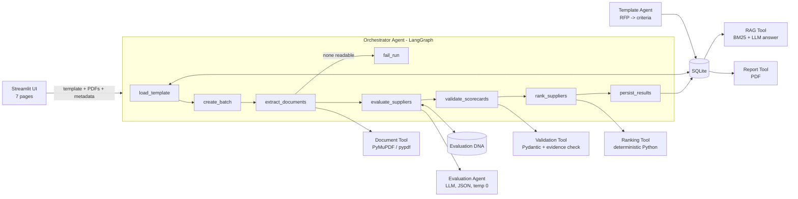

| Component | File | Responsibility |
|---|---|---|
| Orchestrator Agent | `rfp/orchestrator.py` | LangGraph state machine; calls each tool in order, routes around failures, records an execution trace; `rescore_run` re-ranks after overrides with no AI call |
| Template Agent | `rfp/template_agent.py` | Reads the client RFP and drafts criteria, weights and industry benchmarks (LLM, or a rules-based parser offline); weights normalised to 100 |
| Document Tool | `rfp/document_tool.py` | PDF to clean text; strips repeated headers and footers; rejects empty, non-PDF, corrupt or scanned files with a reason |
| Evaluation Agent | `rfp/evaluation_agent.py` | Builds the prompt from the versioned prompt, template context and current criteria; JSON mode; temperature 0; one repair retry |
| Validation Tool | `rfp/validation_tool.py` | Parses JSON (even if wrapped in prose); Pydantic schema; fixes missing, out-of-range or non-numeric scores; checks every evidence quote against the PDF |
| Ranking Tool | `rfp/ranking_tool.py` | Absolute score, benchmarks, gaps, relative %, PPI, Industry Alignment Index, tie-breaks, ranks, explanations, overrides |
| RAG Tool | `rfp/rag_tool.py` | Chunking with page numbers, BM25 retrieval per supplier, cited LLM answer |
| Report Tool | `rfp/report_tool.py` | One-click PDF evaluation report |
| LLM client | `rfp/llm_client.py` | One OpenAI-compatible client for Cohere, OpenRouter, OpenAI and Groq; plain-English error messages |
| Prompts | `rfp/prompts.py` | Default prompts and placeholder validation |
| Persistence | `rfp/db.py` | SQLite schema and all reads and writes |
| UI | `app.py`, `ui/*.py` | Multi-page Streamlit app |

## 3. Scoring formulas

| Metric | Formula |
|---|---|
| Absolute weighted score | Σ (score ÷ max score) × weight → 0-100 |
| Criterion benchmark | highest validated score for the criterion among evaluated suppliers |
| Criterion gap | supplier score − benchmark (0 for the leader, otherwise negative) |
| Relative performance % | supplier score ÷ benchmark × 100; if the benchmark is 0, relative % = 0 for everyone, with a warning |
| **Peer Performance Index (PPI)** | Σ (relative % × weight) ÷ Σ weights; **used for ranking** |
| Industry Alignment Index | Σ (industry score ÷ max score) × weight → 0-100; shown alongside, not used for ranking |

**Mandatory tie-break order:** 1) higher PPI, 2) earlier submission date, 3) higher experience rating,
4) supplier name A-Z. This is one stable sort, after which ranks 1..n are assigned. Scores are rounded to 4 decimals
before sorting so floating-point noise can never change the order. Every adjacent pair gets a written explanation.

**Worked example** (Technical 60%, Commercial 40%): A scores 8 and 5, B scores 4 and 10. Absolute: A = 48 + 20 = 68,
B = 24 + 40 = 64. Benchmarks: 8 and 10. Relative %: A = 100 and 50, B = 50 and 100. PPI: A = (100×60 + 50×40)/100 = 80,
B = 70. A ranks first. This is a unit test.

## 4. Validation rules

| Problem | Action |
|---|---|
| AI reply is not valid JSON | One automatic repair request; if still invalid, all criteria score 0 with a warning |
| JSON wrapped in prose or markdown, trailing commas | Extracted, with a warning |
| Criterion missing | 0 ("no evidence, no points"), with a warning |
| Non-numeric score ("eight") | 0, with a warning |
| Out of range (14/10, −3) | Clipped to 0..max, with a warning |
| Decimal score | Rounded, with a warning |
| Unknown or duplicate criterion | Dropped, or first kept; matched by name if the id is missing |
| Wrong max score | Database value used |
| **Evidence quote not found in the PDF** | Flagged "⚠ not found", with a warning (catches invented quotes) |
| Identical PDF uploaded twice | Evaluated once, scorecard shared, duplicate-submission warning |
| Bad files (scanned, corrupt, not a PDF) | Skipped with a reason; the run continues for the others |
| Supplier metadata | Name required and unique; date valid and not in the future; rating 1-5 (blocks the run) |
| Criteria | Active weights total 100; 2-10 active criteria; unique names (blocks the run) |
| Prompt edits | Required placeholders present, no unknown ones, braces balanced (blocks the save) |

## 5. Evaluation DNA (fingerprint reuse)

Each scorecard is stored under a **fingerprint** = SHA-256 of (model + document SHA-256 + criteria hash + prompt hash).
If the same fingerprint appears again, the stored scorecard is reused: the same proposal always gets the same
evaluation, and no AI call or cost is spent. Changing the document, any criterion, the prompt or the model produces a
new fingerprint and a fresh evaluation. DNA can be switched off per run, and the library can be cleared.

## 6. Database (SQLite)

| Table | Purpose |
|---|---|
| `rfp_templates` | Client RFP templates: buyer, industry, summary, requirements, source file hash and text |
| `evaluation_criteria` | criterion_id, template_id, name, description, industry_benchmark, weight, max_score, is_active |
| `prompt_versions` | Versioned, analyst-editable prompts (one active per prompt) |
| `rfp_runs` | rfp_run_id, created_at, status, template, engine, criteria and prompt snapshot, warnings, full result, revision |
| `supplier_results` | rfp_run_id, supplier_name, submission_date, experience_rating, absolute_score, ppi, industry_index, final_rank, status, result_json |
| `criterion_scores` | One row per supplier × criterion: score, industry score, benchmark, gap, relative %, evidence, verification, override flag |
| `run_documents` | Extracted proposal text per run, used for Q&A and audit |
| `evaluation_dna` | Fingerprint → stored AI scorecard, first run, reuse count |
| `score_overrides` | Analyst overrides: old and new score, reason, analyst, time |

## 7. Running it on Windows (no coding needed)

1. Install **Python 3.12** from python.org, ticking **"Add python.exe to PATH"**.
2. Unzip this project, open the folder and **double-click `run_app.bat`**. The first run sets everything up (2-5
   minutes); your browser then opens at http://localhost:8501.
3. In the sidebar choose **Cohere**, paste your trial key (dashboard.cohere.com → API Keys) and click **Connect**,
   or choose **Offline demo**.
4. Double-click **`run_tests.bat`** to run the 37 automated tests.

Manual alternative (any OS): `python -m venv .venv` → activate it → `pip install -r requirements-dev.txt` →
`streamlit run app.py`.

## 8. Deploying on Streamlit Community Cloud

1. Push this folder to a public GitHub repository, with `app.py` at the top level.
2. share.streamlit.io → **Create app** → your repo, branch `main`, main file `app.py`; Advanced settings → Python 3.12.
3. **Deploy.** No secrets are needed: users paste their own key in the app.

Streamlit Community Cloud storage is temporary, so run history resets when the app restarts or redeploys.
Production would use a managed database with the same schema.

## 9. Demo script (4-5 minutes)

1. **Home:** the five-step journey and the design principle.
2. **Sidebar:** choose Cohere, paste the key, click Connect (the key is never stored).
3. **RFP templates → Create from a client RFP → Use sample: HR service delivery platform → Read RFP and draft
   criteria.** Show the drafted criteria, weights and industry benchmarks; save.
4. **Criteria & prompt:** the weights chart; the prompt editor, version history and full prompt preview.
5. **Evaluate:** load the 5 sample proposals, then Evaluate. Narrate the agent steps.
6. **Results:** leaderboard, peer heatmap, industry view, one scorecard (✔ verified quotes, strengths and risks),
   compare two suppliers, then download the PDF report.
7. **Adjust scores:** change one score with a reason and show the re-rank and the audit log.
8. **Ask the proposals:** "Which suppliers hold ISO 27001 or SOC 2 certification?", with citations.
9. **Error case:** Evaluate → Testing tools: type `BrightPath Tech`, click *Add bad files* and *Add tie-break test
   file*, then Evaluate. Run details shows the clipped, non-numeric, missing and invented-quote warnings, the
   scanned and corrupt PDFs skipped, the duplicate flagged, and rule 3 breaking the tie.
10. **Evaluate the same 5 again:** "5 reused from evaluation DNA", then History & DNA shows AI calls saved.

## 10. Testing

`pytest`: **37 tests** covering hand-checked formulas, all four tie-break rules, zero benchmark, input-order
independence, overrides, every validation rule, evidence checking, prompt placeholder checks and versioning, the
template parser on both sample RFPs, LLM-based template drafting (fake API), JSON-repair retry, friendly API errors,
DNA reuse and invalidation, duplicate documents, bad files, a fully failed run, RAG retrieval, the PDF report, and
an end-to-end run for both domains.

## 11. Assumptions and limitations

- Scores are integers from 0 to max (10 by default); active weights total 100.
- A criterion the AI does not return scores 0 (conservative and auditable).
- The experience rating (1-5) is entered by the analyst and is used only as a tie-breaker.
- Ranking uses PPI, as the brief requires; the absolute score and industry alignment are shown alongside.
- Proposal text beyond 30,000 characters is truncated with a warning. Scanned PDFs are rejected; OCR would be a
  natural next step.
- Q&A uses BM25 keyword retrieval (exact on terms like "ISO 27001"; no embedding model to host).
- The evaluation supports a human procurement decision; it does not replace one.

## 12. Repository structure

```
rfp-evaluator/
├── app.py                     # entry point and navigation
├── ui/                        # one file per page + shared helpers
├── rfp/                       # agents and tools (no Streamlit code)
├── scripts/                   # seed_db.py, make_sample_pdfs.py, export_sample_run.py
├── sample_data/               # templates/, proposals/, edge_cases/, sample_metadata.json
├── sample_output/             # sample exported JSON
├── tests/                     # pytest suite
├── docs/                      # Project_Approach.pdf, screenshots/
├── run_app.bat / run_tests.bat
├── requirements.txt / requirements-dev.txt
└── .streamlit/config.toml
```

## 13. Screenshots

| | |
|---|---|
| 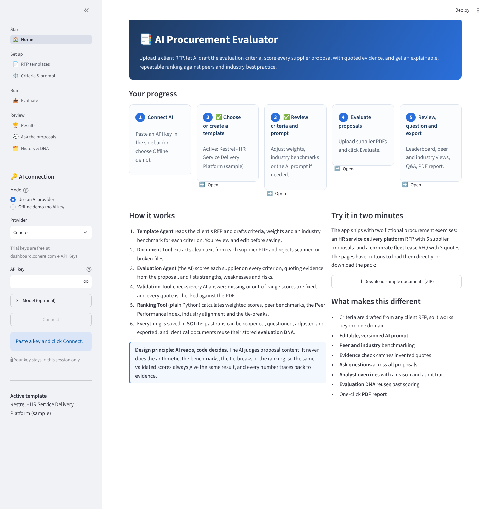 | 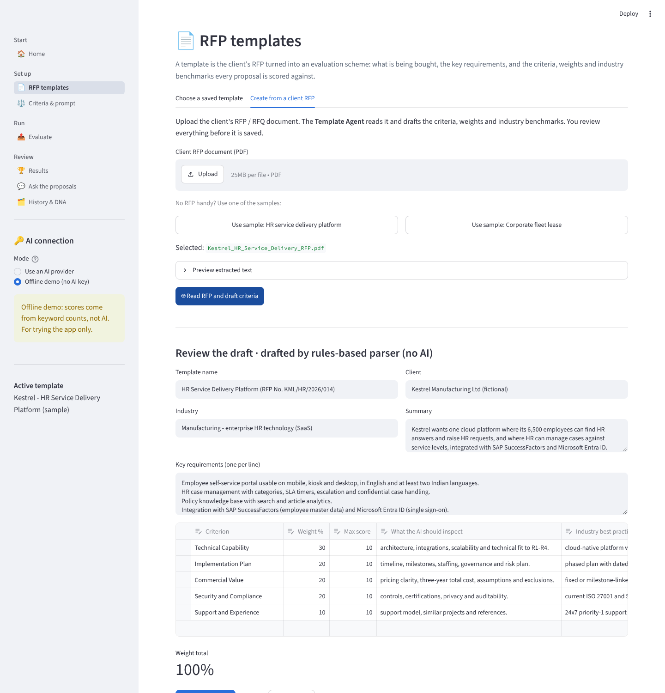 |
| 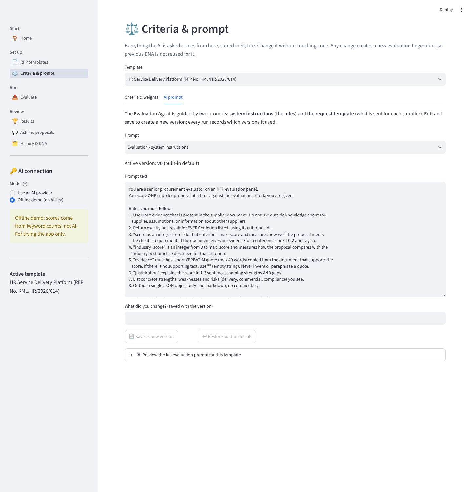 | 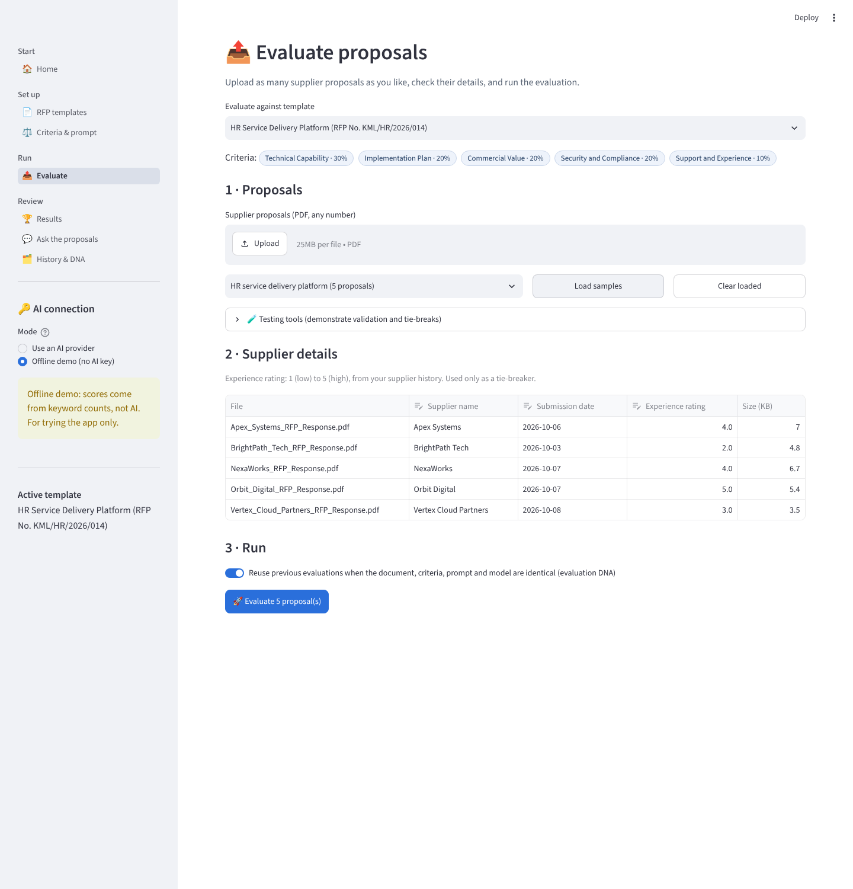 |
| 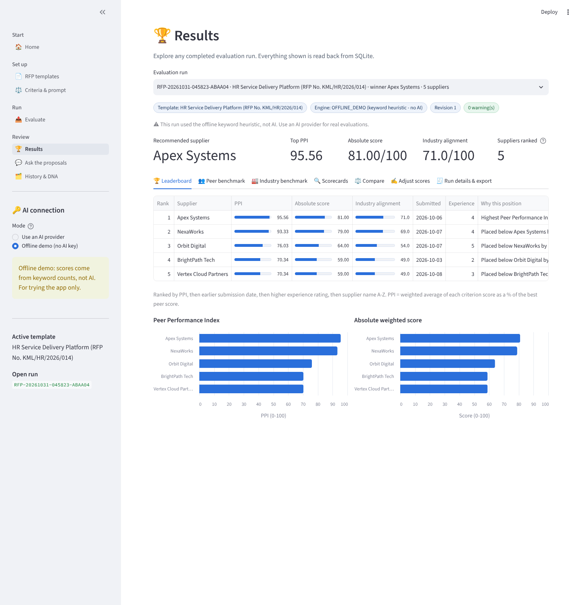 | 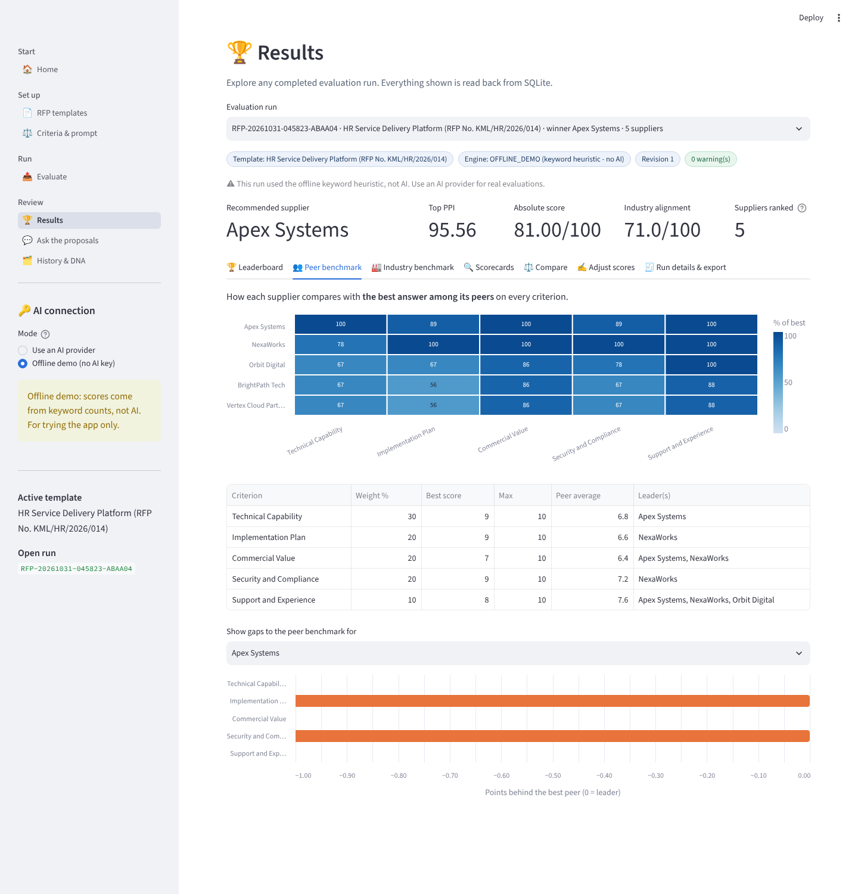 |
| 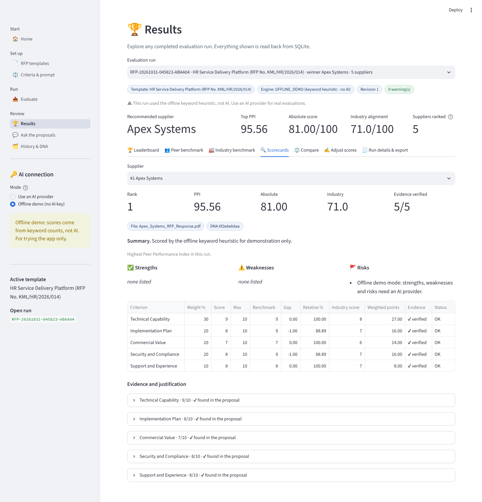 | 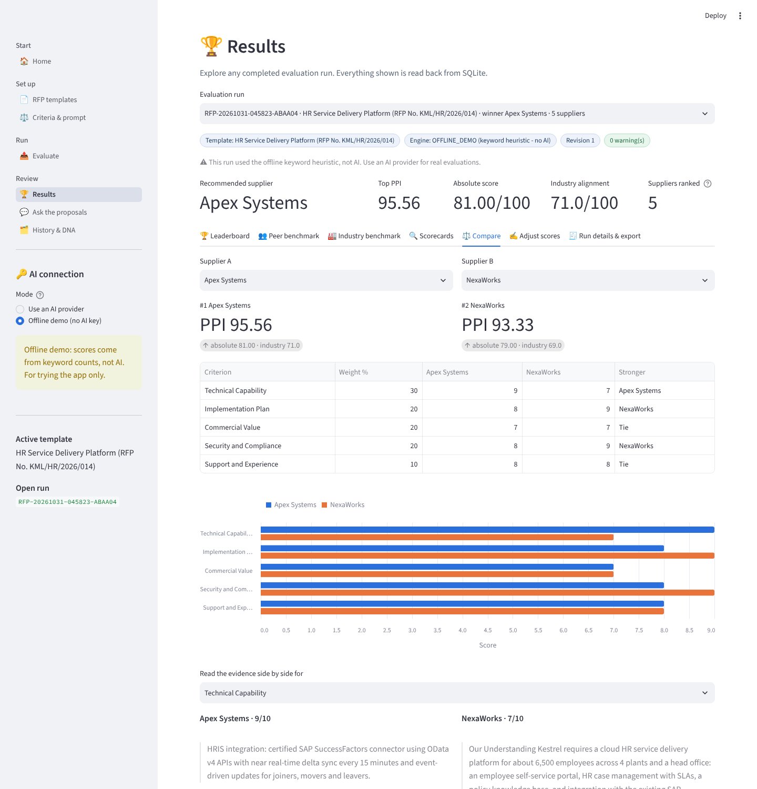 |
| 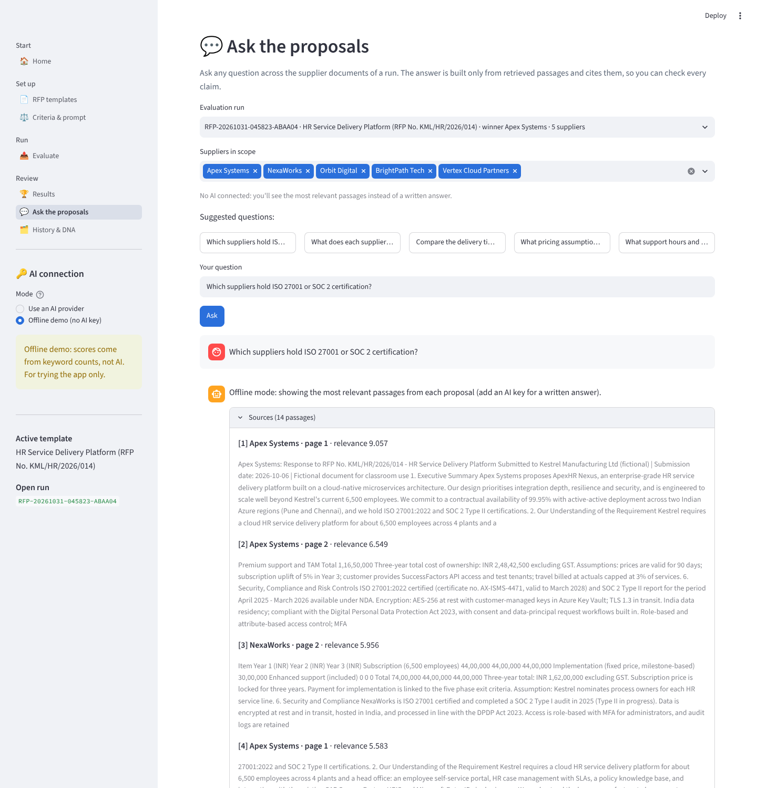 | 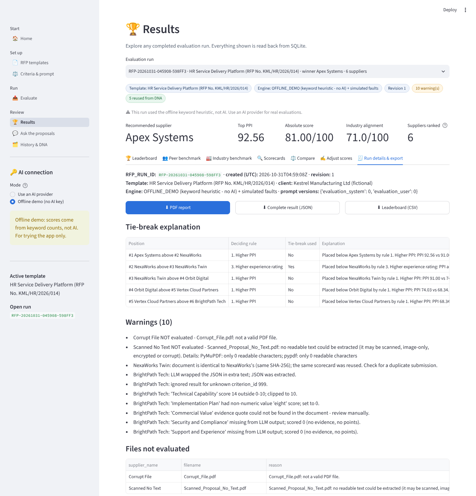 |
