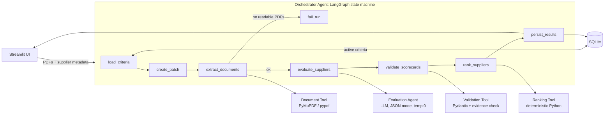
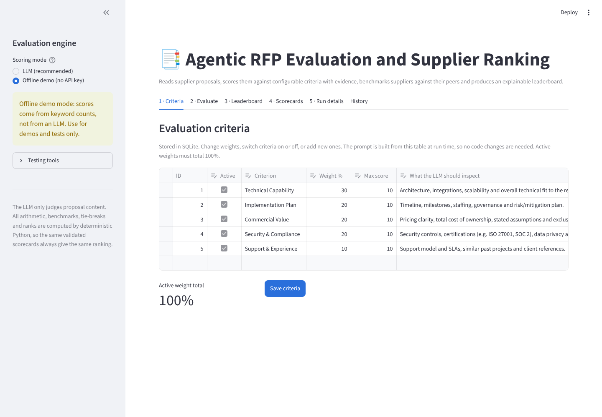
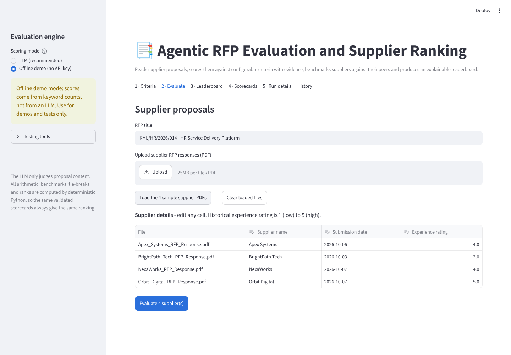
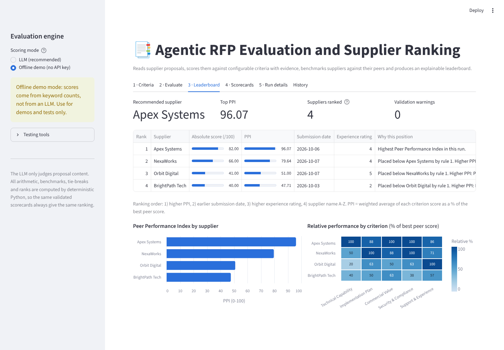
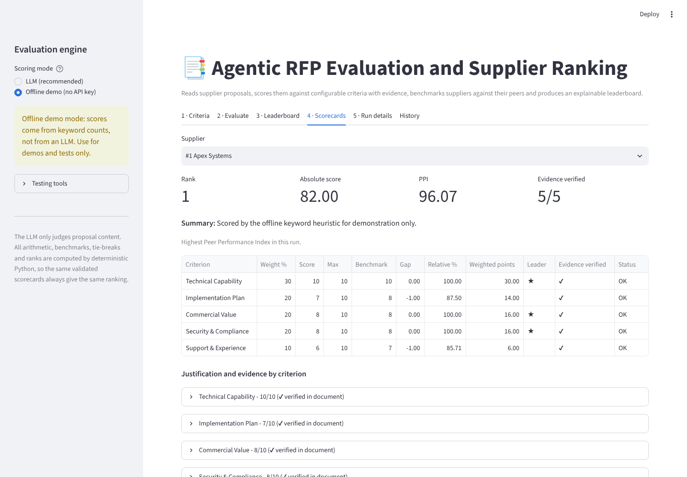
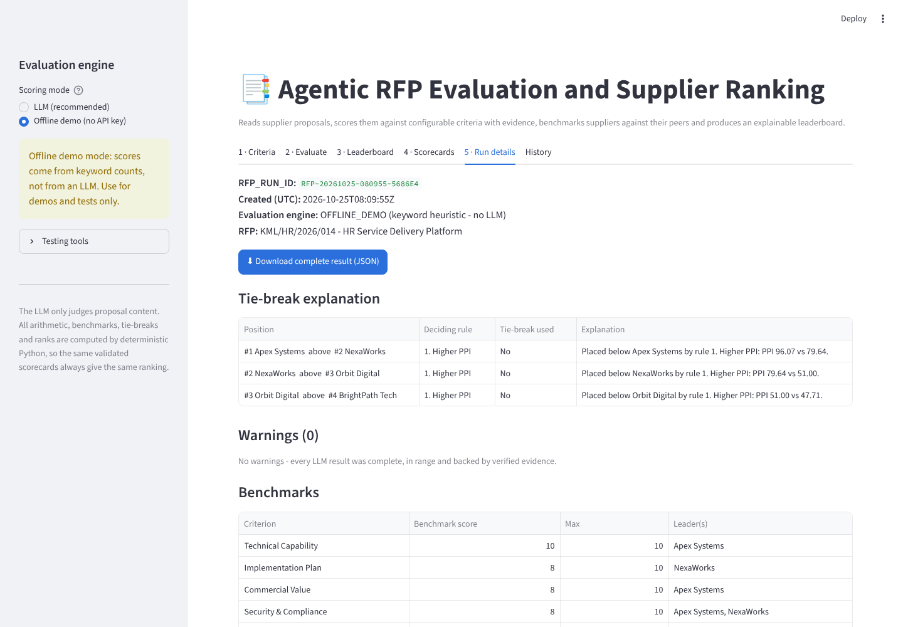
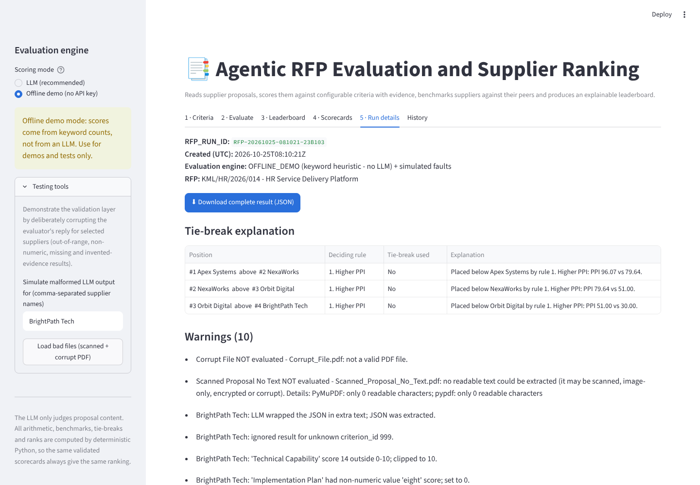

# Agentic RFP Evaluation and Supplier Ranking

An AI-assisted Streamlit application that reads supplier RFP responses (PDF), scores each one against
configurable criteria with evidence quoted from the document, benchmarks suppliers against their peers,
and produces an explainable, reproducible leaderboard.

**Live app:** `<add your Streamlit Community Cloud URL here>`
**Stack:** Streamlit · SQLite · LangGraph · any OpenAI-compatible JSON LLM (OpenRouter by default) · PyMuPDF · Pydantic

> **Design principle:** the LLM judges proposal *content*. It never does the arithmetic, the benchmarks,
> the tie-breaks or the ranking. Those are deterministic Python, so once the scorecards are validated,
> the same inputs always produce the same numbers and the same order. Every final score traces back
> to a criterion, a weight, a verified evidence quote and a business rule.

---

## 1. Business problem

A procurement team receives several supplier proposals for the same RFP. Reading them all and comparing
them consistently is slow and subjective. This app gives every proposal the same independent,
evidence-based review, then applies transparent scoring, peer comparison and tie-break rules.

The sample RFP (fictional) is *KML/HR/2026/014: HR Service Delivery Platform* for Kestrel Manufacturing,
a 6,500-employee manufacturer that needs an employee portal, HR case management and SuccessFactors integration.

## 2. Architecture



| Component | File | Responsibility |
|---|---|---|
| Orchestrator Agent | `rfp/orchestrator.py` | LangGraph `StateGraph` that calls each tool in order, routes around failures (conditional edge), and records an execution trace |
| Document Tool | `rfp/document_tool.py` | Extracts and cleans PDF text (PyMuPDF, with pypdf as fallback); rejects empty, scanned, encrypted or non-PDF files with a clear reason |
| Evaluation Agent | `rfp/evaluation_agent.py` | Builds an evidence-grounded prompt from the **current** criteria, calls the LLM in JSON mode at temperature 0, retries once with a repair prompt if the JSON is invalid, and caches results |
| Validation Tool | `rfp/validation_tool.py` | Parses JSON (even if wrapped in prose or markdown), validates the schema with Pydantic, fills missing criteria, clips out-of-range scores, drops unknown criteria, **checks every evidence quote actually appears in the PDF**, and validates supplier metadata |
| Ranking Tool | `rfp/ranking_tool.py` | Absolute score, benchmarks, gaps, relative %, PPI, the mandatory tie-break sort, sequential ranks and a plain-English explanation of every position |
| Persistence | `rfp/db.py` | SQLite schema, seed criteria, runs, supplier results, per-criterion audit rows, LLM cache |
| UI | `app.py` | Criteria editor, supplier input, leaderboard, scorecards, run details, history, JSON download |

### Data flow (10 steps from the brief)

1. **Setup**: Streamlit starts; the database is created and seeded if needed; active criteria are shown.
2. **Input**: upload supplier PDFs (or click *Load the 4 sample supplier PDFs*) and enter name, submission date and experience rating (1-5).
3. **Batch**: a unique `RFP_RUN_ID` (e.g. `RFP-20261025-080855-F74480`) and a `RUNNING` row are created.
4. **Evaluate**: criteria are **reloaded from SQLite at run time**, text is extracted, the prompt is built and the LLM is called (suppliers in parallel, results re-ordered deterministically).
5. **Validate**: JSON is parsed and every criterion normalised; warnings are recorded.
6. **Score**: absolute weighted score per supplier.
7. **Benchmark**: best score per criterion, gaps and relative %.
8. **Rank**: PPI, the tie-break sort, ranks 1..n.
9. **Persist**: the complete result is written in one transaction under one `RFP_RUN_ID`.
10. **Present**: leaderboard, scorecards with evidence, comparisons, warnings, tie-break explanation, JSON download.

## 3. Scoring formulas

| Metric | Formula |
|---|---|
| Absolute weighted score | Σ (criterion score ÷ max score) × criterion weight, giving 0-100 |
| Criterion benchmark | highest validated score for that criterion across all evaluated suppliers |
| Criterion gap | supplier score − benchmark (0 for the leader, otherwise negative) |
| Relative performance % | supplier score ÷ benchmark × 100 |
| Peer Performance Index (PPI) | Σ (relative % × weight) ÷ Σ weights |

**Zero benchmark (safe handling):** if no supplier scores above 0 on a criterion, every supplier's relative %
for it is set to 0 and a warning is recorded. The criterion cannot tell suppliers apart, so it adds nothing
to anyone's PPI, and nobody gets credit for "matching" a benchmark of zero.

**Mandatory tie-break order:** 1) higher PPI, 2) earlier submission date, 3) higher historical experience rating,
4) supplier name A-Z (case-insensitive). This is one stable sort; ranks 1, 2, 3… are assigned only afterwards,
so ranks are never shared. Scores are rounded to 4 decimals before sorting so floating-point noise cannot change the order.

**Worked example** (two criteria: Technical 60%, Commercial 40%):

| | Technical | Commercial | Absolute | Relative % | PPI |
|---|---|---|---|---|---|
| A | 8 | 5 | 8/10×60 + 5/10×40 = **68** | 100, 50 | (100×60 + 50×40)/100 = **80** |
| B | 4 | 10 | 24 + 40 = **64** | 50, 100 | (50×60 + 100×40)/100 = **70** |

Benchmarks are Technical = 8 (A) and Commercial = 10 (B). A ranks first. This exact case is a unit test.

## 4. Validation and normalisation rules

| LLM output problem | Action |
|---|---|
| Not valid JSON | One automatic repair request; if still invalid, all criteria are scored 0 with a warning |
| JSON wrapped in prose or ```` ``` ```` fences, or with trailing commas | JSON extracted, with a warning |
| Criterion missing | Score 0 ("no evidence, no points") and a warning |
| Score non-numeric (e.g. `"eight"`) | 0 and a warning |
| Score out of range (e.g. 14/10, -3) | Clipped to 0..max and a warning |
| Decimal score | Rounded and a warning |
| Unknown or duplicate `criterion_id` | Dropped, or first kept, with a warning (matched by name if the id is missing) |
| Wrong `max_score` | Database value used |
| Evidence quote not found in the PDF | Flagged ⚠ *not verified*, with a warning (catches invented quotes) |
| Missing justification | "Not provided" and a warning |

**Supplier metadata checks** (these block the run): name required and unique; submission date valid and not in the
future; experience rating between 1 and 5. **Criteria checks** (these also block the run): active weights must total 100%, names unique, max score > 0.
**File checks** (the file is skipped, the run continues): empty, not a PDF, corrupt, encrypted, or scanned with no text layer.

## 5. Database design (SQLite)

| Table | Fields |
|---|---|
| `evaluation_criteria` | criterion_id, name, description, weight, max_score, is_active, updated_at |
| `rfp_runs` | rfp_run_id, created_at, status (RUNNING/COMPLETED/FAILED), rfp_title, evaluation_mode, criteria_snapshot, warnings_json, run_json |
| `supplier_results` | rfp_run_id, supplier_name, submission_date, experience_rating, absolute_score, ppi, final_rank, result_json |
| `criterion_scores` | one row per supplier × criterion: score, benchmark, gap, relative %, weighted points, justification, evidence, evidence_verified *(audit trail)* |
| `llm_cache` | hash of (prompt version, model, supplier, document SHA-256, criteria) → validated-parse LLM reply *(reproducibility, cost control)* |

Criteria are edited in the **Criteria** tab without code changes. Deleted criteria are deactivated rather than
removed, so past runs stay auditable, and each run stores a snapshot of the criteria it used.

## 6. Prompt design

The system prompt tells the model to:
- use **only evidence present in the supplier document**;
- return **one result for every active criterion** (listed with id, max score, weight and description);
- keep every score **within 0..max_score** (with a scoring guide);
- give a **verbatim quote** of 40 words or fewer as evidence, or an empty string if there is none;
- output **JSON only**.

The supplier text is fenced between `DOCUMENT_START` and `DOCUMENT_END` markers. JSON mode (`response_format=json_object`) and
temperature 0 are used where the provider supports them.

## 7. Synthetic supplier proposals

`sample_data/supplier_pdfs/` contains four fictional 2-page proposals for the same RFP, generated by
`scripts/make_sample_pdfs.py`:

| Supplier | Profile built into the document | Price (3-yr, ex-GST) | Timeline |
|---|---|---|---|
| Apex Systems | Strongest technical design and security (ISO 27001, SOC 2 Type II, 99.95% SLA); highest price | INR 2.48 Cr | 18 weeks |
| BrightPath Tech | Lowest price and fastest; vague security ("working towards ISO"), CSV-only integration, 3 small clients, no references | INR 1.01 Cr | 10 weeks |
| NexaWorks | Balanced; most detailed plan (phases, exit criteria, named team, risk register) and strongest support (24x7, service credits) | INR 1.62 Cr | 16 weeks |
| Orbit Digital | Strongest experience (17 years, 40+ implementations, 3 named references); integration "to be finalised after discovery"; integration cost excluded | INR 1.61 Cr (estimate) | ~20 weeks |

`sample_data/edge_cases/` holds a scanned (image-only) PDF and a corrupt "PDF" to demonstrate file validation.
All names, prices and references are invented. No real supplier data is used.

## 8. Setup and running locally

```bash
git clone <your-repo-url> && cd rfp-evaluator
python -m venv .venv && source .venv/bin/activate      # Windows: .venv\Scripts\activate
pip install -r requirements-dev.txt
python scripts/seed_db.py            # creates data/rfp_evaluator.db with the 5 sample criteria (optional: app does this too)
cp .streamlit/secrets.toml.example .streamlit/secrets.toml   # then paste your OpenRouter key
streamlit run app.py
```

- Get a key at https://openrouter.ai (OpenAI and Groq keys also work; pick the provider in the sidebar).
- Default model: `openai/gpt-4o-mini`. Change it in the sidebar or with `LLM_MODEL` in secrets.
- **Offline demo mode** (sidebar) runs the full workflow without a key, using a transparent keyword heuristic
  in place of the LLM. It is clearly labelled and meant only for demos and automated tests.

Run the tests: `pytest` (24 tests: formulas, tie-breaks, zero benchmark, validation and repair, evidence checking,
LLM retry and cache with a fake client, end-to-end workflow, bad files).

## 9. Deploying on Streamlit Community Cloud

1. Push this folder to a **public GitHub repository**.
2. Go to https://share.streamlit.io and choose **Create app → Deploy a public app from GitHub**.
3. Repository: your repo; Branch: `main`; Main file path: `app.py`. Under *Advanced settings*, pick Python 3.12.
4. In *Advanced settings → Secrets*, paste `OPENROUTER_API_KEY = "sk-or-v1-..."`.
5. Click **Deploy**. The SQLite database is created automatically on first start.

Note: Streamlit Community Cloud storage is temporary, so run history resets when the app restarts. That is fine for a
demo; production would use a managed database (e.g. Postgres) with the same schema.

## 10. Demonstration script (3-4 minutes)

1. **Criteria tab**: show the 5 criteria and weights stored in SQLite. Change a weight to show the 100% check blocking evaluation, then change it back.
2. **Evaluate tab**: click *Load the 4 sample supplier PDFs*, show the metadata table, click **Evaluate**, and narrate the agent steps as they appear.
3. **Leaderboard**: rank, absolute score vs PPI, the "why this position" column and the relative-performance heatmap.
4. **Scorecards**: open one supplier and show score, benchmark, gap, relative %, the evidence quote with ✔ verified, and the justification.
5. **Run details**: RFP_RUN_ID, tie-break table, benchmarks, execution trace, **Download JSON**.
6. **Validation case**: in *Testing tools*, type `BrightPath Tech` in the simulate box and click *Load bad files*, then re-run. Show
   the clipped (14 → 10), non-numeric, missing and invented-evidence warnings, plus the scanned and corrupt PDFs skipped
   with reasons. The run still completes for the valid suppliers.

## 11. Assumptions

- Scores are integers from 0 to each criterion's `max_score` (10 by default); weights are percentages of active criteria and total 100.
- A criterion with no result from the LLM scores 0, to stay conservative and auditable.
- Historical experience rating is entered by the procurement user on a 1-5 scale.
- Ranking uses PPI (relative to peers), as the brief requires. Absolute score is shown alongside because it can disagree (see the `test_absolute_and_ppi_can_disagree` test).
- Proposal text beyond 30,000 characters is truncated with a warning; proposals under 200 readable characters are treated as unreadable.
- Scanned PDFs are rejected rather than OCR'd. OCR (e.g. Tesseract or Azure Document Intelligence) is a natural extension.
- The LLM recommendation supports a human procurement decision; it does not replace one.

## 12. Repository structure

```
rfp-evaluator/
├── app.py                         # Streamlit UI
├── rfp/
│   ├── config.py                  # settings, providers, constants
│   ├── db.py                      # SQLite schema, seed, CRUD, cache
│   ├── document_tool.py           # PDF text extraction
│   ├── evaluation_agent.py        # prompt, LLM call, repair retry, cache, offline evaluator
│   ├── validation_tool.py         # JSON parsing, Pydantic, normalisation, evidence check
│   ├── ranking_tool.py            # formulas, benchmarks, PPI, tie-breaks
│   └── orchestrator.py            # LangGraph workflow + execution trace
├── scripts/
│   ├── seed_db.py                 # create/seed database (--reset)
│   ├── make_sample_pdfs.py        # generate the 4 synthetic proposals + edge cases
│   └── export_sample_run.py       # produce a sample JSON export
├── sample_data/                   # synthetic supplier PDFs, edge cases, sample metadata
├── sample_output/                 # sample exported JSON
├── tests/                         # pytest suite
├── docs/screenshots/
├── .streamlit/config.toml         # theme + upload limit
├── .streamlit/secrets.toml.example
├── requirements.txt / requirements-dev.txt
└── README.md
```

## 13. Screenshots

| | |
|---|---|
|  |  |
|  |  |
|  |  |

## 14. Possible extensions

OCR for scanned proposals · a second "challenger" LLM or self-consistency voting for borderline scores ·
human override of a criterion score with a reason, logged for audit · LangSmith tracing and a golden-set
evaluation of scoring accuracy · role-based access and Postgres for production.
